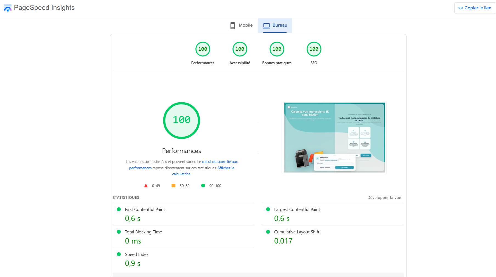
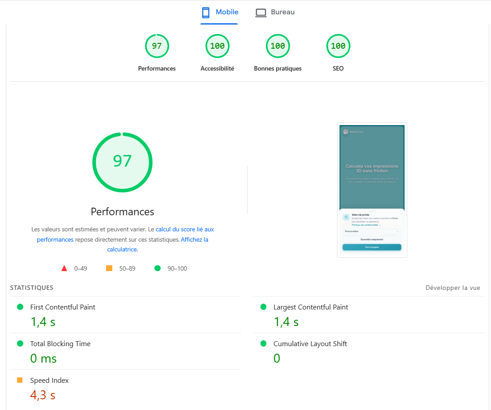

# 09 — Performances Lighthouse

> Testé le 29 mai 2026 · [bambucalc.netlify.app](https://bambucalc.netlify.app/)  
> Outil : Google PageSpeed Insights (Lighthouse 12)

---

## Scores

| | Performances | Accessibilité | Bonnes pratiques | SEO |
|---|:---:|:---:|:---:|:---:|
| 🖥️ Desktop | **100** | **100** | **100** | **100** |
| 📱 Mobile  | **97**  | **100** | **100** | **100** |

---

## Desktop — 100 / 100

| Indicateur | Valeur |
|---|---|
| First Contentful Paint | 0,6 s |
| Largest Contentful Paint | 0,6 s |
| Total Blocking Time | 0 ms |
| Cumulative Layout Shift | 0,017 |
| Speed Index | 0,9 s |

---

## Mobile — 97 / 100

| Indicateur | Valeur |
|---|---|
| First Contentful Paint | 1,4 s |
| Largest Contentful Paint | 1,4 s |
| Total Blocking Time | 0 ms |
| Cumulative Layout Shift | 0 |
| Speed Index | 4,3 s |

---

## Optimisations appliquées

| Action | Impact |
|---|---|
| Lazy loading `CalculatorStep` + `Login` + `Signup` | Bundle 872 KB → 326 KB (-63 %) |
| Preconnect Supabase | DNS résolu en avance |
| PWA manifest + service worker | Install/fetch offline |
| Routes `Dashboard`, `Admin`, `Contact`… | Déjà en lazy loading |
